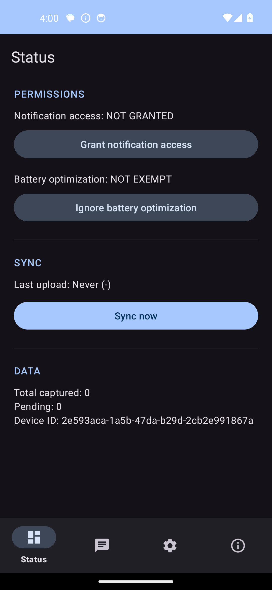
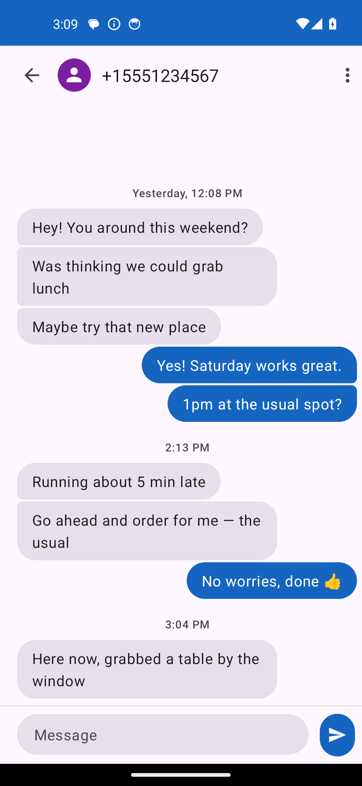
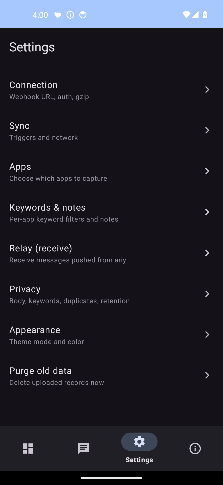

# ariyipp


A lightweight, native-Kotlin Android app that **relays SMS between two of your phones** over an
**end-to-end encrypted** channel. One phone holds the SIM; the other is the one you carry. Incoming
SMS on the SIM phone show up as a chat on your main phone, and you can reply; the SIM phone sends it.

It's **one app with two roles**. Install it on both phones and pick a role on first run (switchable
later): **Main** (the hub you read and reply on) or **Companion** (the SMS phone with the SIM).

## Scope

ariyipp is self-hosted: you run it entirely on your own two phones, on your own [Firebase project](#bring-your-own-firebase-byo-fcm).
This repo doesn't operate a backend, and the maintainer doesn't provide Firebase infrastructure,
service-account credentials, or any hosted service on your behalf. Creating your free Firebase
project and importing its two files onto your phones is a one-time step you do yourself. The APK on
[Releases](../../releases) is built and signed by the maintainer for convenience; building from
source with your own signing key (see [below](#build-from-source)) works exactly the same way.

## Fully vibe coded

ariyipp was entirely vibe coded. Every line of code, every test and this README were written by an
AI coding assistant (Claude Code), working from the maintainer's descriptions, feedback and testing;
none of it was written by hand. It has unit and on-device test suites, but no independent code
review or security audit. Read the code before trusting it with your SMS, and expect rough edges.

## Screens

| Status | Chat | Settings |
| --- | --- | --- |
|  |  |  |

## Features

- **SMS relay, both directions**: incoming SMS on the companion appear as a searchable, compact chat
  on the main device, with a floating date header, a jump-to-latest button, and real delivery-receipt
  ticks (received by companion / handed to SIM / carrier-confirmed); compose on the main device and
  the companion sends it from its SIM.
- **End-to-end encrypted**: messages are AES-256-GCM encrypted with a pre-shared key; the transport
  (FCM) only ever carries ciphertext, and every message is tagged with its direction so it can't be
  bounced back to the phone that sent it. Both phones must run the same version.
- **Encrypted on the phone too**: the app's database (messages, captured notifications, reminders)
  is encrypted at rest with SQLCipher, keyed from the phone's hardware keystore.
- **Safeguards on the companion**: a Security screen there caps how many SMS the main device can
  have it send (20 an hour and 50 a day by default) and can restrict sends to numbers that have
  texted it. Both are set on the companion only, so a leaked main device can't change them.
- **Survives outages**: if FCM drops queued messages while the main device is offline, it asks the
  companion to re-send what it missed.
- **Chat history retention**: relayed messages are kept forever by default, or for as long as you
  set. A repush or catch-up of old SMS is stored quietly instead of buzzing once per message.
- **One-way pairing by QR**: the main device owns and shows the shared key; the companion scans it
  and announces itself back automatically. No copying tokens by hand.
- **Liveness heartbeat**: each device periodically checks the other is reachable. Before warning,
  it asks the other phone to answer straight away and only alerts (with a Retry action) if nothing
  comes back, so a phone that was briefly quiet doesn't raise a false alarm. Any message from the
  other phone counts as a sign of life. Toggle it off if you don't want it.
- **Self-healing push**: when a device's push token rotates it tells the other one automatically,
  and an SMS whose relay fails because of a setup problem is held and retried rather than dropped.
- **Companion device status**: while the main device's Status screen is open, the companion reports
  its battery, signal, network and VPN state as live gauges; it stops the moment you leave the
  screen. Separately, the companion alerts the main device when its battery drops below a threshold
  or its wifi has been down too long; those arrive whether or not the app is open.
- **Reminders** (optional module, off by default): a rulebook over the SMS and notifications ariyipp
  already sees, tracking **bill due dates** and **parking expiry** in their own tab:
  - **Rules from a message**: long-press any message → *Create reminder rule*. An auto-parser drafts
    the sender filter, the amount, currency and due date; override anything, or select text in the
    sample to build a pattern without writing regex. Dates with no year, and formats like
    `06-OCT-26`, are understood.
  - **Runs on arrival**: a matching SMS or notification is processed the moment it arrives; a
    periodic scan backs it up.
  - **Reminders and alarms**: bills remind you ahead at a time you choose, spaced apart when several
    land together; parking sessions extend themselves on renewal and ring an alarm before expiry.
  - **Auto mark-paid**: point a rule at the bank's payment confirmation and the bill it pays is
    settled for you, optionally only when the amount matches. Works for hand-added bills too.
  - **Manual bills**: one-off or repeating every N days/weeks/months/years, with notes, categories,
    a per-bill reminder lead and a "skip next" flag.
  - **30-day total**: one figure for everything due in the next 30 days, in your **default
    currency**: your phone's own (from its SIM, network or region) unless you pick another in
    Reminders settings. Other currencies are converted at daily exchange rates from
    [open.er-api.com](https://open.er-api.com) (fetched at most once a day; the request names only
    your default currency, nothing about you or your bills). Hideable, and a Compact one-line view.
- **Per-conversation mute**, unread badges, one-time-code copy, tappable links, and inline reply from
  the notification.
- **Share & multi-select**: share any message to another app (separate from Forward, which relays it
  as SMS through the companion), and bulk mark-as-read/mute/delete conversations from the Messages
  list.
- **Encrypted backup & restore** through the system file picker, passphrase-protected (AES-256-GCM
  over a PBKDF2-SHA256 key, 600k iterations; a new passphrase needs 16+ characters without repeats
  or runs; older backups still restore). Covers chat history,
  pairing, reminder rules and bills, and every setting.
- **Optional extras:** capture this phone's notifications and forward them to a webhook (https only),
  and push the webhook config to the companion (opt-in on the companion, and it's notified of any
  remote change). Uploads hide one-time codes and full card numbers (a card keeps its last four
  digits); on by default, under Settings > Privacy.
- **Theming:** light/dark/system, Material You, and a true-black AMOLED mode, with every text colour
  checked against WCAG AA contrast in all three.

## How it works

Both phones run the same app. The **main** device receives relayed messages and shows them as chat;
the **companion** device (with the SIM) observes incoming SMS, encrypts each one, and pushes it to
the main device. Everything travels as ciphertext over Firebase Cloud Messaging (data messages,
high priority so they arrive under Doze).

```
 Companion (SIM)                         Main (hub)
 ──────────────                          ──────────
 incoming SMS  ──encrypt──▶  FCM  ──▶  decrypt ▶ chat + notification
 send from SIM ◀──decrypt──  FCM  ◀──  encrypt ◀ compose / reply
```

Pairing is one-way: the main device generates the shared AES key and shows it (plus its push token)
as a QR; the companion scans it, then announces its own push token back over the encrypted channel,
so reverse-send works with nothing copied by hand.

## Why FCM

The transport is Firebase Cloud Messaging, chosen deliberately to **reuse an existing, free, reliable
push channel** rather than stand up and run new infrastructure. FCM delivers data messages even under
Doze / aggressive battery optimization, costs nothing, and needs no self-hosted push server. The
**send** side isn't even a proprietary SDK: it's a plain HTTP v1 REST call authenticated with a
service-account key.

The catch is the **receive** side, which relies on the proprietary `firebase-messaging` / Google Play
Services library. A [UnifiedPush](https://unifiedpush.org) version (a fully open-source, Firebase-free
build) is on the cards if there's enough demand for it.

## Bring your own Firebase (BYO-FCM)

The app ships **without** any Firebase credentials; nothing is baked in at build time. You create a
free Firebase project and import two files **on-device**, so the relay runs entirely on your project.
Do this once; **both phones use the same project** (and the same two files).

You'll import two files, which do different jobs:

| File | What it's for | Which side uses it |
| --- | --- | --- |
| `google-services.json` | identifies the project so the device can **receive** pushes (get an FCM token) | receive |
| service-account key (JSON) | authorizes this device to **send** pushes to the other one | send |

### 1. Create the project and get `google-services.json`

1. Open the [Firebase console](https://console.firebase.google.com) and click **Add project**. The
   free **Spark** plan is enough: FCM has no usage cost at any scale this app would hit. Give the
   project any name; Google Analytics is optional and can be skipped.
2. On the project's Overview page, click the **Android** icon (**Add app**) to register an app.
   - **Android package name** must be exactly **`com.noti.logger`**: this is baked into the APK
     and has to match precisely for the config file to work.
   - The **SHA-1 field can be left blank**: ariyipp doesn't use any Firebase feature that needs it
     (e.g. Dynamic Links, Phone Auth), only Cloud Messaging.
   - You can stop once the config file downloads; the "add the SDK to your project" steps that
     follow are for app developers building from source, not something you do on the phone.
   - Google's own [Add Firebase to your Android project](https://firebase.google.com/docs/android/setup)
     guide covers this same registration flow in more depth, with its own screenshots, if you want a
     second reference.
3. Download the generated **`google-services.json`** and get it onto the phone (email it to
   yourself, save it to a cloud drive, whatever's convenient). Settings → Pairing imports it
   directly from wherever you save it.

### 2. Get the service-account key

The service-account key is what lets a phone **send** a push (compose a message, forward an SMS);
`google-services.json` only lets a phone *receive* one. It's the key of a
[Google Cloud service account](https://cloud.google.com/iam/docs/service-account-overview), a
non-human identity in your project. The phones only ever use it to send FCM messages, so give it
a service account that can do that and nothing else.

Don't use the **Firebase Admin SDK** account that Firebase lists under Project settings → Service
accounts (`firebase-adminsdk-xxxxx@...`). It is set up for a server running the whole Admin SDK
and can read and change much more of your project than push messages, and its key would sit on
two phones.

1. Open [Google Cloud Console → IAM & Admin → Service Accounts](https://console.cloud.google.com/iam-admin/serviceaccounts)
   and pick your Firebase project at the top.
2. Click **Create service account**. Name it something like `ariyipp-push`, then **Create and
   continue**.
3. Under **Grant this service account access to project**, choose the role **Firebase Cloud
   Messaging API Admin** (`roles/firebasecloudmessaging.admin`). That's the only role it needs.
   Click **Continue**, then **Done**.
4. Open the new account, go to the **Keys** tab, and choose **Add key → Create new key → JSON**. A
   JSON file downloads: that file **is** the service-account key you import on both phones.
5. **Treat this file like a password.** Anyone holding it can send push messages as your project,
   though not read your messages: ariyipp's own AES-256-GCM encryption (not this key) protects
   message content, and this key only proves the *sender's* identity to Google. If you ever suspect
   it's leaked, delete the key on the same **Keys** tab, create a new one, and import it on both
   phones.

Already set up with the Firebase Admin SDK key? It keeps working. To switch, create the account
above, import its key on both phones, then delete the old key from the `firebase-adminsdk`
account's **Keys** tab.

6. Confirm the send API is actually enabled: in the Firebase console's **Project settings**, open the **Cloud
   Messaging** tab and check that **Firebase Cloud Messaging API (V1)** shows **Enabled**. New
   projects have it on by default. If it shows disabled, click that row's **Manage API in Google
   Cloud Console** link and enable it there (see Google's
   [Enabling and disabling APIs](https://support.google.com/googleapi/answer/6158841) doc if the
   Cloud Console layout is unfamiliar).

### 3. Import both on each phone

Settings → **Pairing → Import Firebase files** → pick **both** `google-services.json` and the
service-account key (multi-select them, or import one at a time; each updates independently). The
Pairing screen then shows this device's push token and the pairing QR.

> Both files live only in the app's **encrypted on-device settings**: they're never written into the
> repo (and signing keys stay gitignored too). Losing/rotating them just means re-importing.

## Configure on device

1. Install on both phones; pick **Main** on one and **Companion** on the other.
2. On the companion, grant SMS access and exempt it from battery optimization (Status screen).
3. Import the Firebase files on both (see above), then pair: scan the main device's QR from the companion.
4. On the main device, turn on **Receive relayed messages**.

## Webhook payload

Both webhook legs (notification capture on the main device, and SMS forwarding on the companion)
post the same JSON shape: a batch of items.

```json
{
  "batch": [
    {
      "device_id": "3f7c9e2a-...",
      "uid": "3f7c9e2a-...|sms|1735900000000",
      "package": "sms",
      "app_label": "SMS",
      "post_time": "2026-07-03T08:39:00.174Z",
      "title": "+15551234567",
      "text": "From: +15551234567\nMessage: Hello\nSent: 1735899999000\nReceived: 1735900000000\nSim: SIM 1",
      "big_text": null,
      "sub_text": null,
      "category": "sms"
    }
  ]
}
```

- Sent as `POST` with `Content-Type: application/json`, optionally gzipped (`Content-Encoding: gzip`).
- An optional auth header (name and value both configurable, e.g. `Authorization: Bearer <token>`,
  or a custom header for other auth schemes) is added when both are set.
- Forwarded SMS always have `package`/`category` = `"sms"`; captured notifications carry the
  originating app's real package name and label instead.
- Response: any HTTP 2xx means delivered. To confirm records one by one (captured notifications
  only), reply with a JSON array acknowledging each `uid`:

```json
[{ "success": ["uid1"], "failure": ["Key (uid)=(uid2) already exists."] }]
```

  `success` uids are cleared from the local outbox. A `failure` message containing "already exists"
  is also treated as delivered (idempotent retry); any other failure is retried. A 2xx with any
  other body (n8n's default `{"message":"Workflow was started"}`, or none) counts the whole batch
  as delivered, and the app tells you once that the endpoint isn't confirming records. Forwarded
  SMS go one per request and any 2xx is enough.
- Redirects are not followed: a 3xx is reported as a configuration error and the data is held.
  Point the URL straight at the final address.

## Build from source

```bash
./gradlew :app:assembleDebug          # debug APK
./gradlew :app:assembleRelease        # signed release (needs keystore.properties)
```

Release signing reads a gitignored `keystore.properties` (`storeFile`, `storePassword`, `keyAlias`,
`keyPassword`).

## Testing

```bash
./gradlew :shared:test                 # pure-JVM unit tests (crypto, wire, policy)
./gradlew :app:testDebugUnitTest
./gradlew :app:connectedDebugAndroidTest :sender:connectedDebugAndroidTest
```

## Security

- Message bodies are AES-256-GCM encrypted end-to-end; FCM carries ciphertext only.
- Settings that hold secrets (the shared key, service-account JSON) use `EncryptedSharedPreferences`.
- The app is not the default SMS handler and requests only the permissions it needs.

This project is provided **as-is**, with no dedicated security-support channel or vulnerability-
reporting process. It's a single-maintainer, source-available project, not a hosted service. If you
find a security issue, open a GitHub issue. Since every install runs on infrastructure you own (your
own Firebase project, your own devices, your own signing key if you build from source), you're
responsible for reviewing, securing, and operating your own deployment.

## Tech stack

Kotlin, Material 3, Room, WorkManager, Firebase Cloud Messaging (HTTP v1), kotlinx.serialization.

Multi-module: `:app` (the merged application), `:sender` (the companion role, an Android library), and
`:shared` (pure-JVM crypto, the typed wire format, and the FCM sender).

## License

ariyipp is free software licensed under the **GNU General Public License v3.0**: see
[LICENSE](LICENSE) for the full text. In short: you're free to use, study, share, and modify it, but
any derivative you distribute must also be released under the GPL-3.0.
